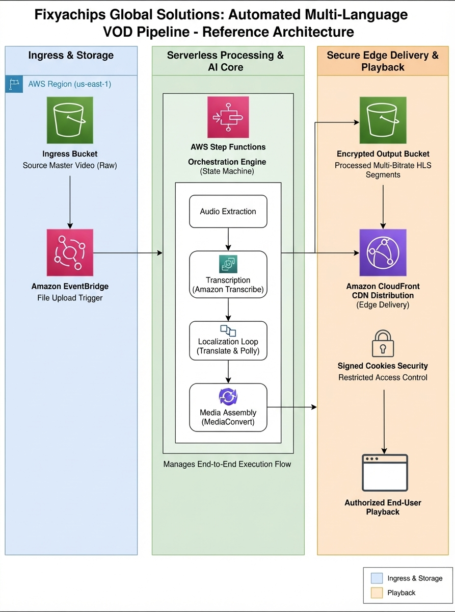

 # Joshua Cane
### Cloud & Serverless Engineer | AWS | Terraform | Bedrock AgentCore

> 10 months building a production VOD platform on AWS.
> Now migrating from CloudFormation to Terraform
> and adding a Bedrock AgentCore AI layer.
> Building in public. Documenting the real version.

---

## Featured Project: Fixyachips VOD & Monetization Platform

A live, production-grade video-on-demand and payment
platform built entirely on AWS serverless infrastructure.

**It processes real payments. It serves real video.
It has 69 IAM roles and a story behind every one.**

### What It Does
- CloudFront CDN with WAFv2, OAC SigV4 signed URLs
- S3 encrypted HLS video delivery (1080p + 720p)
- MediaConvert automated transcoding pipeline
- Stripe payment processing end to end
- DynamoDB student entitlement management
- Lambda workers for all async processing
- KMS encryption on all sensitive data stores
- CloudWatch alarms and XRay distributed tracing

### Current Status: October 2026
Version 4.5.1 is live. The platform works.
Now I am doing it right.

Full migration from CloudFormation to Terraform
with a Bedrock AgentCore AI layer being added
for 6-language HLS pipeline management.
6-week timeline. Zero downtime target.

| Week | Focus | Status |
|------|-------|--------|
| 1 | Terraform foundation + import 30+ CF resources | 🔄 Active |
| 2 | Security + Storage + CDN in Terraform | ⏳ Pending |
| 3 | Compute + API layer + Lambda externalization | ⏳ Pending |
| 4 | Data + Auth + Cognito import | ⏳ Pending |
| 5 | Bedrock AgentCore net-new build | ⏳ Pending |
| 6 | Cutover + CloudFormation decommission | ⏳ Pending |

---

## Architecture

---

## Core Technical Skills

**Cloud & IaC**
AWS CloudFormation, Terraform (migrating now),
S3, CloudFront, Lambda, API Gateway,
DynamoDB, SQS, KMS

**Media & Payments**
AWS Elemental MediaConvert, HLS transcoding,
Stripe API, Checkout Sessions, Webhook HMAC

**Security**
WAFv2, IAM least-privilege, Secrets Manager,
OAC SigV4, HSTS, CSP policies, KMS CMK

**AI Layer (adding now)**
Amazon Bedrock AgentCore, action groups,
OpenAPI tool schemas, 6-language VOD pipeline

**Observability**
CloudWatch Alarms, XRay tracing, SQS DLQs,
SNS alerting

---

## Build Log

10 months of real infrastructure work.
See the Issues tab for the bugs I actually hit,
how I diagnosed them, and how I fixed them.

No happy path documentation here.

---

## Connect

- **Platform:** fixyachips.com
- **Email:** info@fixyachips.com
- **LinkedIn:** www.linkedin.com/in/aws-solutions-architect-serverless-solutions

 
